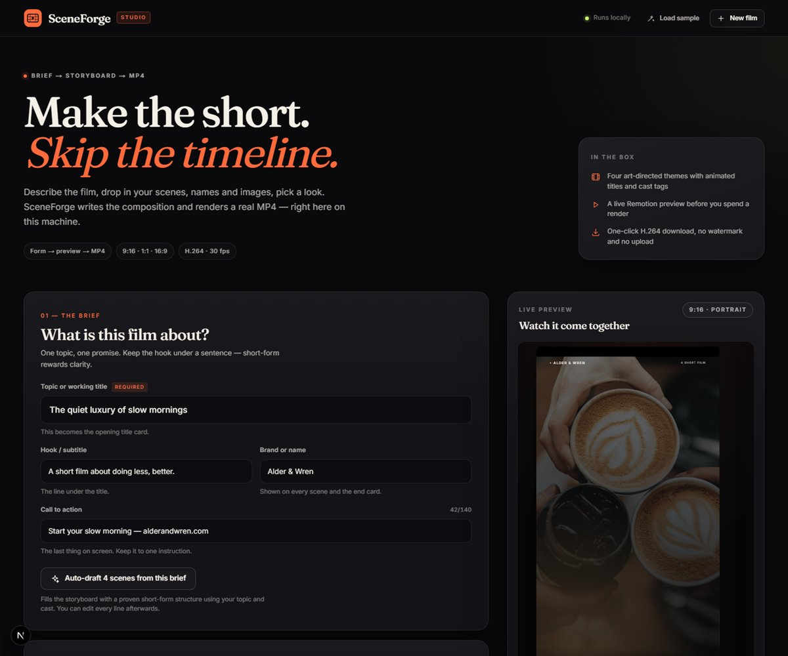

# SceneForge

A local short-video studio. Fill in a brief, storyboard a handful of scenes, pick a look, preview it live, and render a real H.264 MP4 that you can download.

No timeline editor, no API keys, no upload service, and no watermark.




## What it does

- **Brief** — topic, hook, brand, CTA, theme, and aspect ratio (9:16, 1:1 or 16:9).
- **Storyboard** — up to 10 scenes, each with a heading, body copy, image, duration (1.5–12s), animated transition, and an optional cast member.
- **Cast** — up to 6 people with a name, role, and portrait for the lower-third tag.
- **Look** — four art-directed themes: Cinematic, Neon Pop, Editorial, and Signal.
- **Sound & pacing** — optional background music (MP3/WAV/M4A/OGG), captions on/off, title and outro lengths.
- **Preview** — a real Remotion Player with scrubbing, scene jump chips, and fullscreen.
- **Render** — the server bundles the composition, renders every frame with headless Chrome, encodes H.264, and streams the result with HTTP Range support for seeking.
- **Autosave** — the current project is stored in `localStorage`; renders stay listed for the session.

## Requirements

- **Node.js 20+** (tested with Node 22.14.0 — Next 15 does not run on Node 14 or older).
- **Google Chrome or Microsoft Edge** installed. Remotion is pointed at the local browser when one is found; otherwise it downloads its own Chrome Headless Shell on the first render.
- Windows, macOS, or Linux. The app was built and verified on Windows.

## Quick start

```bash
npm install
npm run dev
```

Open <http://localhost:4310>. The first page compile can take a few seconds; the first render also downloads/caches the Remotion browser assets if Chrome was not found.

On this Windows machine the system Node is older than Next 15 supports. Prefix the portable Node 22 install before running npm:

```powershell
$env:Path='C:\Users\clavi\AppData\Local\Temp\opencode\portable-node\node-v22.14.0-win-x64;' + $env:Path
npm run dev
```

Production build:

```bash
npm run build
npm start
```

Stop `npm run dev` before building. If `next build` reports `Invariant: no direct app page entry found for /_not-found`, delete `.next` and rebuild — sharing that directory between the dev and production compilers corrupts it.

## Scripts

| Script | What it does |
| --- | --- |
| `npm run dev` | Next.js dev server on port 4310 |
| `npm run build` | Production build |
| `npm start` | Serve the production build on port 4310 |
| `npm run typecheck` | `tsc --noEmit` |
| `npm run studio` | Open the Remotion Studio for the `ShortVideo` composition |
| `npm run render` | Render the default sample to `out/scene-forge.mp4` with the Remotion CLI |

## How a render works

1. The form sends the project JSON to `POST /api/render`.
2. The API normalizes and validates it (`src/shared/normalize.ts`), stores an in-memory job, and returns a `jobId` immediately.
3. `@remotion/bundler` bundles `src/remotion/index.ts` with `public/` mounted as the static directory.
4. `selectComposition` reads `calculateMetadata` to get the exact frame count and dimensions for this project.
5. `renderMedia` renders the composition with headless Chrome and encodes H.264 (CRF 23, `veryfast` preset, JPEG quality 80).
6. The MP4 is written to `.renders/<jobId>.mp4` — deliberately **outside** `public/` — and served by `GET /api/render/<jobId>/video`, which supports `Range` requests for player seeking and `?download=1` for a named attachment.
7. The preview panel polls `GET /api/render/<jobId>` for progress and the final URLs.

Renders are bundled per job rather than cached. That is slower, but it means a file uploaded a moment ago is guaranteed to be inside the bundle. Uploaded files live in `public/uploads/` and render output lives in `.renders/`; both are gitignored.

## Project layout

```
src/
  app/
    page.tsx                     Studio entry
    layout.tsx                   Fonts and metadata
    globals.css                  Full studio design system
    api/render/route.ts          POST render, bundling, progress store
    api/render/[jobId]/route.ts  Job status JSON
    api/render/[jobId]/video/    MP4 streaming, Range/206, HEAD
    api/upload/route.ts          Image/audio upload validation
  components/
    studio.tsx                   Form, state, autosave, scene/cast editing
    preview-panel.tsx            Remotion Player, progress, download, history
    fields.tsx                   Field, MediaPicker, AudioPicker, Toggle
    icons.tsx                    Inline SVG icon set
  remotion/
    Root.tsx                     Composition registration + calculateMetadata
    ShortVideo.tsx               Timeline assembly, audio, progress bar
    cards.tsx                    Title, scene, and outro cards
    visual.tsx                   Backgrounds, grain, cast tag, animated words
    fonts.ts                     Google Fonts loading for the render
  shared/
    types.ts                     Project, Scene, CastMember, Timeline
    defaults.ts                  Sample and empty projects
    normalize.ts                 Server/client normalization + validation
    timeline.ts                  Frame math and aspect formats
    themes.ts                    Theme tokens, transitions, aspect presets
    draft.ts                     Local "auto-draft" copy generator
    presets.ts                   Unsplash starting images
  lib/
    browser.ts                   Chrome/Edge detection for Remotion
    render-store.ts              In-memory job registry and render directory
```

## Notes and limits

- **Local by design.** The render route runs Node-only Remotion packages, writes to disk, and depends on a headless browser. It is built for `next dev`/`next start` on your machine, not for serverless hosting.
- **One render at a time.** A second request joins the active job instead of starting another Chromium instance.
- **Jobs are in memory.** Restarting the server clears the history, but finished MP4s remain in `.renders/` until you delete them. The upload folder grows until you clean it out; `DELETE /api/upload` is available for that.
- **Remote images must be public HTTPS URLs.** The normalizer also accepts same-origin `/uploads/...` files and rejects everything else, so a render cannot read arbitrary local paths.
- **Fonts.** The composition uses locally registered Google Fonts; the UI uses `next/font`.
- **Render time.** A 23-second 1080×1920 film is ~690 frames and took roughly 2.5 minutes on the development machine. Smaller aspects and fewer scenes are proportionally faster.

## Licensing

SceneForge is an application built on [Remotion](https://www.remotion.dev/). Remotion is free for individuals and companies of up to three people; larger companies need a Remotion company license. Review the [Remotion license](https://github.com/remotion-dev/remotion/blob/main/LICENSE.md) before using this in a commercial product. The Unsplash images used by the presets remain subject to the [Unsplash license](https://unsplash.com/license).
